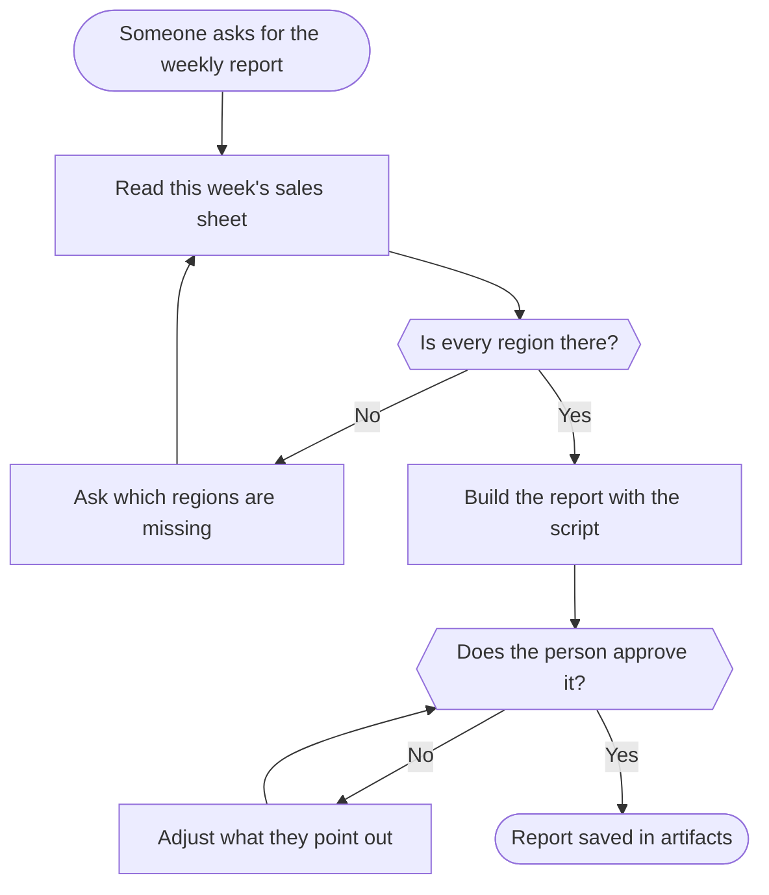

# Rule: skills

Applies when creating, migrating or editing a skill.

## Format

- One folder per skill: `.agents/skills/<skill-name>/`, lowercase, words joined by hyphens.
- `SKILL.md` starts with front matter that has **`name`** (same as the folder) and **`description`**:
  what the skill does and *when* to use it, in the words the team would use to ask for it.
  Agents only read the description up front, so it decides whether the skill is ever used.
- Optional `scripts/` for code and `templates/` for fixed text or layouts.

## Flow diagram (first thing after the title)

The team page shows each skill as a picture before any text, so a teammate sees at a glance
what the AI will do and where it stops to check or ask. Right after the `# Title` line,
`SKILL.md` has a `## Flow` section with one Mermaid flowchart, then the instructions:

````
## Flow


````

- **Steps are boxes** `[...]`; **checks and questions to the person are hexagons** `{{...?}}`
  (the team page colours them so they stand out),
  with labelled `Yes` / `No` arrows. Start and end are rounded `([...])` with `:::done`.
- Top to bottom (`flowchart TD`), 5 to 12 shapes. One shape per numbered step or check in the
  instructions, in the same order; merge small steps rather than drawing every detail.
- Short labels in the team's language and in plain words: what happens, not how. No file
  paths, commands, script names or tool names.
- Put a label in quotes when it has brackets, parentheses or other symbols: `B["Save (draft)"]`.
- **Keep it true.** Whenever the steps or checks change, update the diagram in the same change.
  The team checks refuse to save a skill without it.

## Content

- **Deterministic first.** Any step that must give the same result every time (calculations,
  file transforms, building an HTML report) goes in a script in `scripts/`. The instructions
  tell the agent when to run it; the agent does not redo it by hand.
- **Works for anyone on the team.** No personal paths (`/Users/<name>/...`, `C:\Users\...`),
  personal emails, personal IDs or machine-specific settings. Use paths relative to the
  repository and ask for anything person-specific at run time.
- **No secrets.** Never put tokens, passwords or keys in a skill. Read them from the
  environment and say in `SKILL.md` which variable is needed.
- **Self-contained.** Everything the skill needs to work is written in the skill or in a rule
  of this repository, never in someone's personal memory or chat history.
- **Tools it uses are listed.** Name the connectors (MCP) and commands the skill needs at the
  end of `SKILL.md` under `## Tools`, so permissions can be checked.

## After changing a skill

Run `sh .agents/system/bin/py .agents/system/scripts/sync.py` so Claude Code and Codex both see the change.
