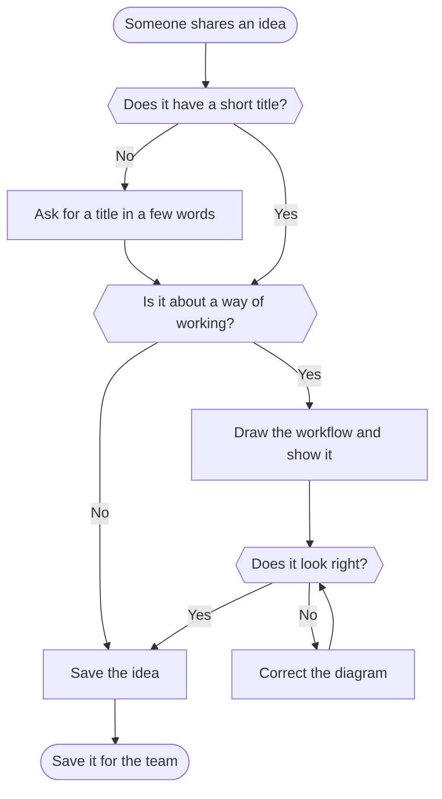

# Add an idea

## Flow



## Steps

1. **Title.** Use the person's own words. If they did not give a short title, ask for one in a
   few words (one short question). Never make it up.

2. **Is it a way of working?** If the idea describes steps people follow (who starts it, what
   happens next, which tools, what comes out), draw its workflow. If it is something else (a
   tool to try, a training, a page), skip to step 4.

3. **Draw the workflow at once**, from what the person told you, and show it in the chat as a
   `mermaid` block. Use the same style as the team's skills:
   - `flowchart TD`, steps in short plain words, in the team's language.
   - The first and last steps rounded and marked done: `A([...]):::done`.
   - Questions as `{{...?}}` with `-- Yes -->` / `-- No -->` (`-- Sí -->` / `-- No -->` in Spanish).
   - One `%% <letter>: <one plain sentence>` line per step saying what happens there.
   - At most about 12 steps. Mark guesses as questions in the notes instead of inventing details.

   Ask in one line whether it looks right. Correct it until they say yes.

4. **Save the idea**, with the description in the person's own words:

   ```
   sh .agents/system/bin/py -I .agents/system/scripts/ideas.py add --title "<title>" --text "<description>"
   ```

   It answers with the idea's `id`. If there is a diagram, write it to a temporary file (outside
   the team folder) and attach it:

   ```
   sh .agents/system/bin/py -I .agents/system/scripts/ideas.py flow --id <id> --file "<temporary file>"
   ```

5. **Save it for the team** straight away:

   ```
   sh .agents/system/bin/py -I .agents/system/scripts/propose_change.py --summary "New idea: <title>" --paths IDEAS.md .agents/ideas
   ```

   Tell them in one line that the idea is on the team page, under Ideas, with its workflow if it
   has one ("See the workflow").
