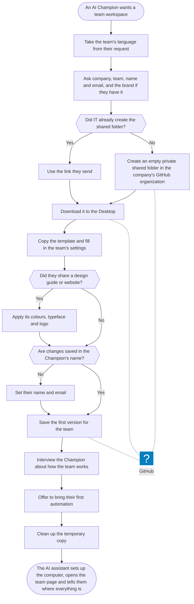

# Create a team's repository

## Flow



You are helping an **AI Champion** create their team's shared AI workspace, usually during
the first workshop. They do not want to read long texts.

**Interview them, one question per message.** Each message is at most two or three short lines:
one question, plus a few words of why only when it helps. Wait for the answer before the next
question. Never list several questions or explain what comes later. Never mention step numbers,
the guide or what you read ("I downloaded the template and read..."): just ask.

**Do not ask permission for the steps.** The Champion asked for their team's folder: creating
the shared folder on GitHub, downloading it, copying the template, applying the brand, saving
and cleaning up are all part of that. Say what you are doing in one short line and do it
("Creating your team's shared folder on GitHub..."). Only ask for information you do not have.
Stop and ask only when something is not as expected (a folder with that name already exists, a
check fails).
Talk in the Champion's language. Keep it short and friendly; they may not be technical.
Do not show commands, file paths or how scripts work unless they ask; you still read scripts
before running them.

This skill is **template-only**: it is never copied into the team's repository.

You are probably running from a temporary copy of the template. Call it `TEMPLATE_DIR`.

## 1. Language

Do not ask. The team's language is the language the Champion wrote their request in (a
Spanish request means a Spanish team): `en` or `es`. Talk to the Champion in it from now on.
This template serves both; the language decides the team's README, its folder names
(`documents/` and `artifacts/`, or `documentos/` and `artefactos/`), the team page's language
and which version of the team skills it gets (`migrate-skill` or `migrar-skill`).

Ask only if the request is in neither language or mixes them. Your first message is one line
with the language and the first question of step 2, for example: "I'll set up your team in
English. What's your company called?" The Champion can correct the language there.

## 2. Company, team and the AI Champion

The Champion is learning: most have never used GitHub. With them, never say "repository",
"owner", "clone" or "launcher". Say **the team's shared folder** (it lives on GitHub and on
each teammate's computer) and **the icon you double-click to open it**.

Ask these one at a time, in this order, each in its own short message:

1. "What's your company called?"
2. "And your team?"
3. Their full name and GitHub email. **Look first, then confirm instead of asking.** Check, in
   order: what your app already knows about the person (Claude and Codex often know the
   signed-in account's name and email),
   `git config --global user.name` and `user.email`, and `gh api user --jq .name,.email` if `gh`
   is signed in. If you find them, one line: "I'll put you down as Maria Prado
   (maria@acme.com), the email you use on GitHub. Right?" Ask only for what is missing:
   "Your full name?" / "Which email do you use on GitHub? If you have no account yet, the one
   you'll use."
4. Optional: "Do you have an official design guide from your company? If not, its website."
   A design guide is best: it has the exact colours, fonts and logo; from a website, take the
   logo too. Keep what they give for step 5b; if they have neither, move on.
5. "Did someone at your company (for example IT) already create a shared folder on GitHub
   for your team and send you a link?"

Do not ask for their GitHub username: you learn it later (step 3 or 5).
If one answer already gives the next one (e.g. "Maria Prado, maria@acme.com"), skip it.

After question 5:

- **Yes:** ask for the link. It looks like `https://github.com/<owner>/<repo-name>`; take both
  from it and skip creating it in step 3. It must be empty and the Champion must be able to
  manage it; if not, tell them to ask the person who created it.
- **No:** ask if they already have a GitHub account with that email. If not, guide them one instruction per message: open
  https://github.com/signup, sign up with that email, choose the **Free** plan, confirm the
  email GitHub sends, and tell you when done. The shared folder will live in the **company's
  GitHub organization** (step 3), never in their own account: their account must be a member of
  it. If it is not, tell them in one line to ask whoever manages the company's GitHub (often IT)
  to add them, and wait.

Tell them the name in one short line, without asking (they can ask for another one):

- **Shared folder name:** `<company>-<team>-ai`, lowercase, hyphens (e.g. `acme-sales-ai`); for a
  Spanish team it ends in `-ia` (e.g. `acme-ventas-ia`). This is the repository name on GitHub.
  If the shared folder already exists, keep its name as it is: do not propose another one.

In the same message, one line (nothing to choose): their Desktop will get a folder `<Team>-AI`
(e.g. `Sales-AI`; `<Team>-IA` for a Spanish team, e.g. `Ventas-IA`), with an icon of the same
name they double-click to open it. Internally that is the launcher name. Explain how the team
shares changes only if they ask.

In the rest of this skill, `<Team>-AI` stands for that name: read it as `<Team>-IA` for a Spanish team.

## 3. Create the EMPTY shared folder on GitHub

Skip this step when the company already created it (step 2).

The team's repository must contain only the Champion's own commits, never ours. So it starts
**empty** and receives the template's files as plain files (no template history).

**Team folders always live in the company's GitHub organization, never in a personal
account**, so the company keeps them and the team that helps every area adopt AI can see them.

**If you can create it yourself** (`gh auth status` succeeds, or a GitHub connector can create
repositories): the Champion's GitHub username is the signed-in account
(`gh api user --jq .login`). The owner is the company's organization: list the Champion's
organizations (`gh api user/orgs --jq '.[].login'`). With one, use it and name it in your
line; with several, ask which one is the company's; with none, stop and ask them to get added
(step 2). Say in one line that you are creating it, and create it.

```
gh repo create <organization>/<repo-name> --private
```

Then, if the organization has a team for AI adoption (list them with
`gh api orgs/<organization>/teams --jq '.[] | .slug + " " + .name'`; its name or slug says
AI or IA adoption), give it read access so it can follow the team's skills and ideas, and say so
in one line. If there is none, skip it without mentioning it.

```
gh api -X PUT orgs/<organization>/teams/<team-slug>/repos/<organization>/<repo-name> -f permission=pull
```

**Otherwise, guide the Champion click by click, one instruction per message** (wait for
"done" before the next):
1. Open https://github.com/new (sign in if GitHub asks).
2. Owner: the company's organization (not their own name). Repository name: `<repo-name>`.
   Visibility: **Private**.
3. Leave **everything else empty**: no README, no .gitignore, no license.
4. Click **Create repository**, then paste you the address of the page that opens
   (`https://github.com/<organization>/<repo-name>`).

## 4. Download it to the Desktop

The Champion opened you on their Desktop. Still find the real Desktop (it moves with
OneDrive and language on Windows) and use that path:

```
sh TEMPLATE_DIR/.agents/system/bin/py TEMPLATE_DIR/.agents/skills/create-team-repo/scripts/desktop_path.py "<Team>-AI"
```

It prints the Desktop path, then `free` or `exists` for `<Desktop>/<Team>-AI`. Do not check
with another command (a failing check looks like an error to the Champion). If it `exists`, stop and ask the Champion what it is; never mix
files into it. Otherwise download the empty shared folder there:

```
git clone https://github.com/<owner>/<repo-name>.git "<Desktop>/<Team>-AI"
```

Git warns that the repository is empty: that is expected. If it asks the Champion to sign in
to GitHub, tell them to follow the window that opens.

## 5. Copy the skeleton and configure it

From `TEMPLATE_DIR`:

```
sh .agents/system/bin/py .agents/skills/create-team-repo/scripts/configure.py \
  --target "<Desktop>/<Team>-AI" --company "<company>" --team "<team>" --language <en|es> \
  --champion-name "<full name>" --champion-email "<GitHub account email>" [--champion-github "<username>"]
```

Pass `--champion-github` only when you learned the username in step 3 and the shared folder
is in the Champion's own account; otherwise leave it out and the script reads it from `gh`
when it can.

It copies the template's files (not its history, and not the template-only skills), swaps in
the team skills in the team's language, writes the team settings, creates the visible folders
and the team README in the team's language, renames the launchers. Nothing in the new repository points
back to the template.

## 5b. Company brand (if they gave a design guide or website in step 2)

Do this before the first save, so the brand travels in it and the first double-click already
shows the company's logo on the folder and its icon.

1. Find the brand. From a design guide they attach: read the colours, the typeface's name (and
   whether it is serif or sans) and the logo from it; if the guide comes with the font files,
   use them. From a website: its main colour (buttons, header), background and text
   colours, the typeface its text uses (the first name in its `font-family`), and its logo
   (prefer a square PNG logo, e.g. the site's icon; download it). A guide wins over the website
   when they differ.
2. Save it straight away, without asking, inside the team folder, and say in one line what you
   used, for example: "Applied We Are's brand: orange (#F54D23) on near-black, Space Grotesk and
   the logo from the website." The Champion can ask for a change later.

   ```
   sh .agents/system/bin/py .agents/system/scripts/brand.py --primary "<#hex>" \
     [--background "<#hex>"] [--text "<#hex>"] [--font sans|serif] [--logo "<logo file>"] \
     [--font-family "<typeface>"] [--font-file "<font file>" ...]
   ```

3. It works on any computer. If it answers `"icons": "made on the next launch"`, this computer
   cannot make the icons yet: the first launch (step 10) makes them from the logo.

Reports and dashboards the AI makes from now on use these colours and logo (artifacts rule).

## 6. Make sure commits are in the Champion's name

Every commit must be authored by the Champion. In the new folder, check:

```
git config user.name
git config user.email
```

If either is missing or does not match the name and GitHub email from step 2, set them for
this repository only (no need to tell the Champion; they already confirmed their name and email):

```
git config user.name "<full name>"
git config user.email "<GitHub account email>"
```

Then save the first version straight to the team's main version, **without asking**: it is
part of creating the folder they asked for, and they confirmed the details already.

```
git add --all
git commit -m "Set up <team> AI workspace"
git branch -M main
git push -u origin main
```

The team's checks run on this commit (generated files, secrets, skills). If they stop it,
explain the message in plain words and fix it. Never commit or push under any other name.
When it is saved, say it in one line (e.g. "Saved the first version for the team.") and go on.

## 7. How the team works

Now interview the Champion about how the team works, following `.agents/rules/team-context.md`
in the team folder: one question per message, in the team's language. It writes
`.agents/team-context.md`, which the AI assistant reads before every task for the team, saves
it for the team, and ends with 2 or 3 ideas that fit the team best. If the Champion has no time
now, tell them in one line that they can ask for it later ("let's set up how my team works")
and go on.

## 8. First automation

Offer to bring their first automation into the team now with **migrate-skill** (**migrar-skill**
for a Spanish team): they can
paste or attach a skill, script, instructions or macro they already use.

## 9. Clean up

Delete `TEMPLATE_DIR` (the temporary copy). No need to tell the Champion.

## 10. Prepare this computer, open the team page and close

This is the last step. Do it yourself; do not ask the Champion to double-click the icon. Say
in one line what you are doing ("Preparing your computer and opening your team's page...").

The same two commands work on Mac and on Windows (Claude Code runs them in Git Bash there), and
they need no approval from the Champion. In the team folder:

1. Prepare the computer, and wait for it (the first time takes a minute or two):
   ```
   cd "<Desktop>/<Team>-AI" && sh .agents/system/bin/setup
   ```
   It installs uv and Python, turns on the team checks, applies the brand and icons, hides
   technical files, trusts the folder in Codex and, on Windows, puts Git's `sh` on the Champion's
   own PATH. It ends with `Setup finished.`; the same lines are in `.git/launch.log`.
2. Start the team page in the background (it keeps running while this conversation does):
   ```
   cd "<Desktop>/<Team>-AI" && sh .agents/system/bin/team-page
   ```
   It prints `The team page is ready at http://127.0.0.1:<port>`.

- **The address is there:** open it in your own browser (in the Claude desktop app, the built-in
  browser) so the Champion sees the team page next to the chat. If you have no browser of your
  own, open it in the computer's browser (`open <address>` on a Mac, `start <address>` on
  Windows). Look at each section before going on and fix what does not read well on the brand
  (contrast, logos, buttons on two lines); if you cannot see it, ask the Champion in one line
  whether it looks right. (The icons are made from the logo on each computer and never saved:
  nothing is left to save after the launch.)
- **Setup says GitHub's tool is missing or not signed in, or Git is missing:** those need the
  Champion (an installer or a browser sign-in). Ask them to double-click **`<Team>-AI.command`**
  (Mac) or **`<Team>-AI.bat`** (Windows), in the `<Team>-AI` folder on their Desktop, mentioning
  only their system's file, for example: "Hacé doble clic en Adopcion-IA.bat, dentro de la
  carpeta Adopcion-IA de tu Escritorio." Then read `.git/launch.log`; never ask them to copy the
  window. If a blue "Windows protected your PC" box appears, they click **More info**, then
  **Run anyway**; on a Mac, if it was blocked, right-click the file and choose **Open**.
- **Anything else:** explain the last lines in plain words and help fix them
  (`.agents/rules/setup-problems.md` in the team folder).

**Check the computer before closing.** In the team folder, run
`sh .agents/system/bin/py -I .agents/system/scripts/doctor.py` and follow
`.agents/rules/setup-problems.md` (in the team folder) for anything that is not ok, so the folder
is ready for the team without the Champion having to troubleshoot. On Windows this matters most:
Codex needs Git's `sh` on the PATH, and Python may be the Store placeholder. Say in one line that
the computer is ready, or what is left.

Then close. Tell the Champion, in three short lines: where the folder is, how to open it next
time (the `<Team>-AI.command` on a Mac, or the `<Team>-AI` shortcut on Windows, which replaces
the `.bat` after the first launch; then choose the folder in their AI assistant), and what comes
next (adding teammates is a later step with their facilitator).

## Tools

- Shell: `git`, `gh` (optional), `sh .agents/system/bin/py <script>`
- Never cherry-pick, merge or push template commits into the team's repository.
- Scripts: `scripts/desktop_path.py`, `scripts/configure.py`
