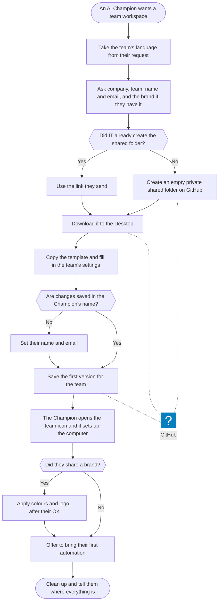

# Create a team's repository

## Flow



You are helping an **AI Champion** create their team's shared AI workspace, usually during
the first workshop. They do not want to read long texts.

**Interview them, one question per message.** Each message is at most two or three short lines:
one question, plus a few words of why only when it helps. Wait for the answer before the next
question. Never list several questions or explain what comes later. Never mention step numbers,
the guide or what you read ("I downloaded the template and read..."): just ask.

**Ask before every action** that creates, downloads or publishes anything.
Talk in the Champion's language. Keep it short and friendly; they may not be technical.
When you ask for OK, say what will happen in plain words (one or two lines). Do not show
commands, file paths or how scripts work unless they ask; you still read scripts before running them.

This skill is **template-only**: it is never copied into the team's repository.

You are probably running from a temporary copy of the template. Call it `TEMPLATE_DIR`.

## 1. Language

Do not ask. The team's language is the language the Champion wrote their request in (a
Spanish request means a Spanish team): `en` or `es`. Talk to the Champion in it from now on.
This template serves both; the language decides the team's README, its folder names
(`documents/` and `artifacts/`, or `documentos/` and `artefactos/`), the team page's language
and which version of the team skills it gets (`migrate-skill` or `migrar-skill`).

Ask only if the request is in neither language or mixes them. Your first message is one line
with the language and the first question of step 2, for example: "I'll set up your team in
English. What's your company called?" The Champion can correct the language there.

## 2. Company, team and the AI Champion

The Champion is learning: most have never used GitHub. With them, never say "repository",
"owner", "clone" or "launcher". Say **the team's shared folder** (it lives on GitHub and on
each teammate's computer) and **the icon you double-click to open it**.

Ask these one at a time, in this order, each in its own short message:

1. "What's your company called?"
2. "And your team?"
3. Their full name and GitHub email. **Look first, then confirm instead of asking.** Check, in
   order: what your app already knows about the person (Claude and Codex often know the
   signed-in account's name and email),
   `git config --global user.name` and `user.email`, and `gh api user --jq .name,.email` if `gh`
   is signed in. If you find them, one line: "I'll put you down as Maria Prado
   (maria@acme.com), the email you use on GitHub. Right?" Ask only for what is missing:
   "Your full name?" / "Which email do you use on GitHub? If you have no account yet, the one
   you'll use."
4. Optional: "Did they give you your company's design guide (brand manual)? If not, its website
   or logo works too. I'll use them for the team's page and the reports the AI makes." A design
   guide is best: it has the exact colours, fonts and logo. Keep what they give for step 7b; if
   they have nothing, move on.
5. "Did someone at your company (for example IT) already create a shared folder on GitHub
   for your team and send you a link?"

Do not ask for their GitHub username: you learn it later (step 3 or 5).
If one answer already gives the next one (e.g. "Maria Prado, maria@acme.com"), skip it.

After question 5:

- **Yes:** ask for the link. It looks like `https://github.com/<owner>/<repo-name>`; take both
  from it and skip creating it in step 3. It must be empty and the Champion must be able to
  manage it; if not, tell them to ask the person who created it.
- **No:** ask if they already have a GitHub account with that email. If not, guide them one instruction per message: open
  https://github.com/signup, sign up with that email, choose the **Free** plan, confirm the
  email GitHub sends, and tell you when done. The shared folder will live in their own account.

Propose the name, and confirm in one short message:

- **Shared folder name:** `<company>-<team>-ai`, lowercase, hyphens (e.g. `acme-sales-ai`).
  This is the repository name on GitHub. Skip it when the folder already exists.

In the same message, one line (nothing to choose): their Desktop will get a folder `<Team>-AI`
(e.g. `Sales-AI`), with an icon of the same name they double-click to open it. Internally that
is the launcher name, `<Team>-AI`. Explain how the team shares changes only if they ask.

## 3. Create the EMPTY shared folder on GitHub

Skip this step when the company already created it (step 2).

The team's repository must contain only the Champion's own commits, never ours. So it starts
**empty** and receives the template's files as plain files (no template history).

**If you can create it yourself** (`gh auth status` succeeds, or a GitHub connector can create
repositories): the owner is the signed-in account (`gh api user --jq .login`), which is also
the Champion's GitHub username. Say what you will create, in plain words, and wait for OK.

```
gh repo create <owner>/<repo-name> --private
```

**Otherwise, guide the Champion click by click, one instruction per message** (wait for
"done" before the next):
1. Open https://github.com/new (sign in if GitHub asks).
2. Repository name: `<repo-name>`. Visibility: **Private**. Leave the owner as it is.
3. Leave **everything else empty**: no README, no .gitignore, no license.
4. Click **Create repository**, then paste you the address of the page that opens
   (`https://github.com/<owner>/<repo-name>`). The owner in it is their GitHub username.

## 4. Download it to the Desktop

The Champion opened you on their Desktop. Still find the real Desktop (it moves with
OneDrive and language on Windows) and use that path:

```
sh TEMPLATE_DIR/.agents/system/bin/py TEMPLATE_DIR/.agents/skills/create-team-repo/scripts/desktop_path.py "<Team>-AI"
```

It prints the Desktop path, then `free` or `exists` for `<Desktop>/<Team>-AI`. Do not check
with another command (a failing check looks like an error to the Champion). If it `exists`, stop and ask the Champion what it is; never mix
files into it. Otherwise ask before downloading the empty shared folder there:

```
git clone https://github.com/<owner>/<repo-name>.git "<Desktop>/<Team>-AI"
```

Git warns that the repository is empty: that is expected. If it asks the Champion to sign in
to GitHub, tell them to follow the window that opens.

## 5. Copy the skeleton and configure it

From `TEMPLATE_DIR`:

```
sh .agents/system/bin/py .agents/skills/create-team-repo/scripts/configure.py \
  --target "<Desktop>/<Team>-AI" --company "<company>" --team "<team>" --language <en|es> \
  --champion-name "<full name>" --champion-email "<GitHub account email>" [--champion-github "<username>"]
```

Pass `--champion-github` only when you learned the username in step 3 and the shared folder
is in the Champion's own account; otherwise leave it out and the script reads it from `gh`
when it can.

It copies the template's files (not its history, and not the template-only skills), swaps in
the team skills in the team's language, writes the team settings, creates the visible folders
and the team README in the team's language, renames the launchers. Nothing in the new repository points
back to the template.

## 6. Make sure commits are in the Champion's name

Every commit must be authored by the Champion. In the new folder, check:

```
git config user.name
git config user.email
```

Show the result: "Your changes will be saved as: <name> <email>". If either is missing or
does not match the name and GitHub email from step 2, set them for this repository only:

```
git config user.name "<full name>"
git config user.email "<GitHub account email>"
```

Then, after showing a one-line summary of what will be saved and getting OK:

```
git add --all
git commit -m "Set up <team> AI workspace"
git branch -M main
git push -u origin main
```

The team's checks run on this commit (generated files, secrets, skills). If they stop it,
explain the message in plain words and fix it. Never commit or push under any other name.

## 7. Prepare this computer

Ask the Champion to double-click the **`<Team>-AI`** icon in the new folder and tell you when
a window has opened and stopped moving. The first time it installs what is needed, turns on
the team checks, hides technical files and lets Codex use the team rules, then opens the
team page in the browser (keep the window open while using it).

You cannot see that window, and never ask the Champion to copy it: read
`<Desktop>/<Team>-AI/.git/launch.log`, where the launcher writes what the window shows.

- No log: the launcher has not run yet. On Mac, if it was blocked, right-click the icon and
  choose **Open**; on Windows, if a blue "Windows protected your PC" box appears, click
  **More info**, then **Run anyway**.
- `Setup finished.` and `Launcher finished.`: done.
- Anything else: explain the last lines in plain words and help fix them.

## 7b. Company brand (if they gave a website, brand guide or logo in step 2)

1. Find the brand. From a website: its main colour (buttons, header), background and text
   colours, and its logo (prefer a square or SVG/PNG logo; ask before downloading it, saying
   from where). From a design guide or logo file they attach: read the colours, the font
   (serif or sans) and the logo from it; a guide wins over the website when they differ.
2. Show it in plain words and wait for OK, for example: "Main colour: dark blue (#0B3D91).
   Background: white. Logo: the one at the top of your website."
3. Save it (uv is installed by the launcher in step 7):

   ```
   ~/.local/bin/uv run --quiet --no-project --python 3.12 --with pillow \
     .agents/system/scripts/brand.py --primary "<#hex>" [--background "<#hex>"] [--text "<#hex>"] \
     [--font sans|serif] [--logo "<logo file>"]
   ```

   On Windows, uv is `%USERPROFILE%\.local\bin\uv.exe`. Run it inside the team folder.
4. Ask the Champion to close the team page window and double-click the icon again: the page
   shows the company colours and logo, and the folder gets the company's icon.
5. Save it for the whole team (AGENTS.md, "Sharing changes"), with `--paths .agents/brand.json
   .agents/brand`.

Reports and dashboards the AI makes from now on use these colours and logo (artifacts rule).

## 8. First automation

Offer to bring their first automation into the team now with **migrate-skill** (**migrar-skill**
for a Spanish team): they can
paste or attach a skill, script, instructions or macro they already use.

## 9. Clean up and close

- Delete `TEMPLATE_DIR` (the temporary copy), after saying so.
- Tell the Champion, in three short lines: where the folder is, how to open it (the
  `<Team>-AI` icon, then choose the folder in Claude or Codex), and what comes next (adding
  teammates is a later step with their facilitator).

## Tools

- Shell: `git`, `gh` (optional), `sh .agents/system/bin/py <script>`
- Never cherry-pick, merge or push template commits into the team's repository.
- Scripts: `scripts/desktop_path.py`, `scripts/configure.py`
