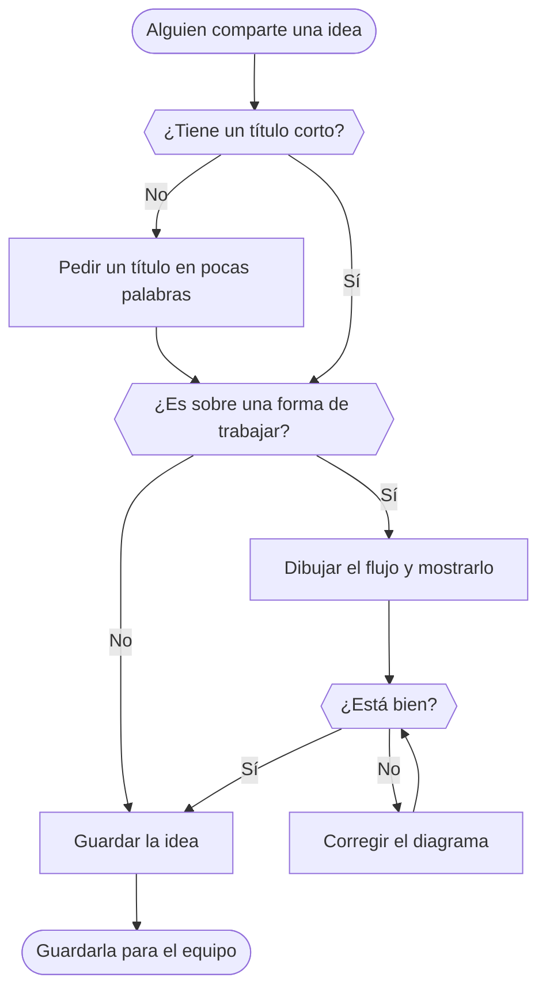

# Agregar una idea

## Flujo



## Pasos

1. **Título.** Usá las palabras de la persona. Si no dio un título corto, pedile uno en pocas
   palabras (una sola pregunta). Nunca lo inventes.

2. **¿Es una forma de trabajar?** Si la idea describe pasos que sigue la gente (quién empieza,
   qué pasa después, con qué herramientas, qué sale al final), dibujá su flujo. Si es otra cosa
   (una herramienta para probar, una capacitación, una página), pasá al paso 4.

3. **Dibujá el flujo de una vez**, con lo que te contó la persona, y mostralo en el chat como un
   bloque `mermaid`. Usá el mismo estilo que las skills del equipo:
   - `flowchart TD`, pasos en palabras simples y cortas, en español.
   - El primer y el último paso redondeados y marcados: `A([...]):::done`.
   - Las preguntas como `{{...?}}` con `-- Sí -->` / `-- No -->`.
   - Una línea `%% <letra>: <una frase simple>` por paso, que diga qué pasa ahí.
   - Como mucho unos 12 pasos. Lo que no sepas, dejalo como pregunta en las notas en vez de inventarlo.

   Preguntá en una línea si está bien. Corregilo hasta que diga que sí.

4. **Guardá la idea**, con la descripción en las palabras de la persona:

   ```
   sh .agents/system/bin/py -I .agents/system/scripts/ideas.py add --title "<título>" --text "<descripción>"
   ```

   Responde con el `id` de la idea. Si hay diagrama, escribilo en un archivo temporal (fuera de
   la carpeta del equipo) y sumalo:

   ```
   sh .agents/system/bin/py -I .agents/system/scripts/ideas.py flow --id <id> --file "<archivo temporal>"
   ```

5. **Guardala para el equipo** enseguida:

   ```
   sh .agents/system/bin/py -I .agents/system/scripts/propose_change.py --summary "Nueva idea: <título>" --paths IDEAS.md .agents/ideas
   ```

   Contale en una línea que la idea está en la página del equipo, en Ideas, con su flujo si lo
   tiene ("Ver el flujo").
