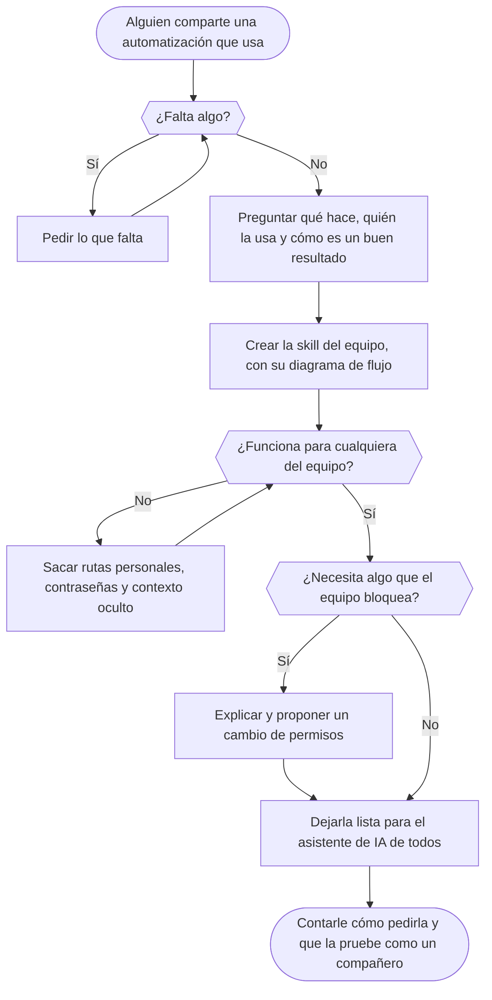

# Migrar una skill al equipo

## Flow

Cualquiera del equipo puede tener automatizaciones que viven solo en su computadora. Esta skill
convierte una de ellas en una skill del equipo que funciona para cualquiera, sin la
configuración, la memoria ni las credenciales de esa persona.

Leé `.agents/rules/skills.md` y `.agents/rules/safety.md` antes de empezar.
Hablale a la persona en palabras simples; nunca le pidas que edite archivos ni que corra comandos.

## 1. Recibir la automatización

La persona la comparte en el chat: texto pegado, archivos adjuntos, la ruta de una carpeta o una
descripción. Si falta algo (un script que las instrucciones llaman, una plantilla, un ejemplo
del resultado esperado), pedilo ahora.

Preguntá, en un solo mensaje:
- Qué hace y **quién del equipo la va a usar**.
- **Cómo es un buen resultado** (un ejemplo, si lo tiene).
- Cómo la pide normalmente (las palabras que escribiría). Eso se convierte en la descripción.

## 2. Crear la skill del equipo

- Elegí un nombre corto, en minúsculas y con guiones, y confirmalo con la persona.
- Creá `.agents/skills/<nombre>/SKILL.md` con `name` y `description` en el encabezado, en
  español, el idioma del equipo.
- Justo después del título, agregá el diagrama `## Flow`: los pasos como cajas, cada control o
  pregunta a la persona como un hexágono, las herramientas que usa unidas a sus pasos, con sus
  logos, y una línea de detalle por paso (`.agents/rules/skills.md`). Las etiquetas del diagrama van en español. La página del
  equipo lo muestra primero.
- Pasá los pasos fijos a `scripts/` (primero lo determinístico). Dejá como instrucciones solo lo
  que necesita criterio.
- Nunca escribas en `.claude/` ni en `.codex/`.

## 3. Que funcione para el resto del equipo

Revisá cada punto y corregilo. Anotá lo que cambiaste para el resumen.

| Control | Qué buscar | Cómo corregirlo |
|---|---|---|
| Rutas y datos personales | `/Users/<nombre>/`, `C:\Users\`, emails personales, IDs personales, una computadora en particular | Rutas relativas a la carpeta del equipo; pedir los datos personales al usarla |
| Credenciales | Tokens, contraseñas, claves de API en el texto o en los scripts | Sacarlas; leerlas de una variable de entorno y nombrarla en `SKILL.md` |
| Herramientas y conectores | Conectores (MCP), comandos y programas que usa | Listarlos en `## Tools`; compararlos con `.agents/permissions.json` (paso 4) |
| Contexto oculto | Cosas que solo funcionaban por la memoria, el historial o las instrucciones personales de la persona (nombres, formatos, dónde están los datos) | Preguntarle; escribir ese contexto en la skill o proponer una regla del equipo en `.agents/rules/` |
| Resultados | Dónde quedan | Seguir `.agents/rules/artifacts.md`; nunca enviar mensajes, solo borradores |

## 4. Permisos

Compará las herramientas que necesita la skill con `.agents/permissions.json`.
- Si necesita algo que está bloqueado, explicalo en palabras simples y proponé un cambio.
  Nunca edites `permissions.json` sin el acuerdo de la persona.
- Si la skill envía mensajes, cambiala para que prepare borradores.
- Proponé los permisos propios de la skill: lo que puede hacer sin preguntar mientras corre
  (leer, sus propios scripts, borradores), como reglas acotadas (`.agents/rules/skills.md`).
  Explicá cada uno en palabras simples y agregá los que la persona acepte con `skill_permissions.py`.

## 5. Sincronizar y entregar

1. Corré `sh .agents/system/bin/py .agents/system/scripts/sync.py` para que Claude Code y Codex vean la skill.
2. Contale a la persona, en pocas líneas:
   - el nombre de la skill y cómo pedirla,
   - qué cambiaste para que funcione para los demás (del paso 3),
   - si propusiste un cambio de permisos y si se aplicó,
   - el próximo paso: probarla como lo haría un compañero, sin su propia configuración,
     y después pedirle a alguien del equipo que la pruebe.

## Tools

- Shell: `sh .agents/system/bin/py .agents/system/scripts/sync.py`, `sh .agents/system/bin/py .agents/system/scripts/find_logo.py` (búsqueda de logos en internet), `sh .agents/system/bin/py -I .agents/system/scripts/skill_permissions.py` (permisos propios de la skill)
- Lectura y escritura de archivos dentro de `.agents/`
