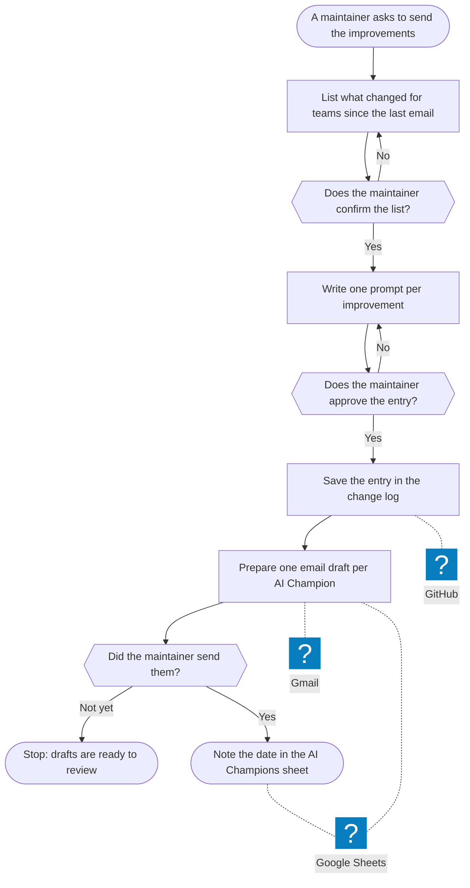

# Email improvements to the AI Champions

## Flow



For **maintainers of this template**, never for AI Champions. Everything you write here is for
**non-technical** people.

Team folders are never updated from here. Each company decides: the email suggests
improvements, and the AI Champion applies the ones they want by pasting a prompt in their own
team folder. Their assistant explains, asks, applies and saves it for their team.

This skill is **template-only**: it is never copied into a team's folder.

## 1. What changed

Find the last entry (the newest `## ` heading in `.agents/skills/improvement-email/CHANGES.md`
and the commit that added it), then list what changed for teams since then:

```
git log --oneline <that commit>..HEAD -- .agents AGENTS.md CLAUDE.md Team-AI.command Team-AI.bat ':!.agents/skills/create-team-repo' ':!.agents/skills/improvement-email'
```

Group the changes into improvements a team would notice. Confirm the list with the maintainer.

## 2. Write one prompt per improvement

A prompt is pasted by the Champion in Claude or Codex **opened in their team folder**. It must
work on its own, months later, in a folder that may have changed. Shape:

```
In this team folder, <what to improve, in one plain sentence>.
Get the files from https://github.com/mfprado/ai-team-template (download it to a temporary
folder): <the exact files or folders to bring, e.g. .agents/system/facade/app.py>.
Compare them with ours, explain in plain words what will change, and ask me before changing
anything. Keep our own skills, rules, settings and brand. Then check it works and save it
for the whole team.
```

Rules for prompts:
- One improvement per prompt, so the Champion can take some and skip others.
- Name exact files; never "update everything".
- If an improvement needs another one first, say so in the prompt ("Only after ...").
- For new safety rules in `permissions.json`, the prompt lists the rules to **add**; never
  replace their file.

## 3. Write the entry

Add a new entry at the top of `CHANGES.md` (below the intro):

```
## <YYYY-MM-DD> — <short title>

### <Improvement title>
<one or two plain sentences: what gets better for the team>

Prompt:
> <the prompt>
```

No jargon (no "hook", "repo", "commit", "MCP"). Show it to the maintainer and adjust until
approved, then commit and push it to the template (the maintainer's own commit).

## 4. Prepare the emails (drafts only)

Read the **AI Champions** Google Sheet with the **Google Sheets connector** (`get_values`;
spreadsheet id `192RjrWGwOgeHM53p0V8AjqvLkmzMeVZpndW6fGTQqB8`). Columns: Name, Email, Company,
Team, Team repository, Language, Core version, Onboarding date, Last email sent, Notes.
Skip rows without an email. If the Sheets connector is not connected, read it with the Google
Drive connector (`read_file_content`) and tell the maintainer to connect Google Sheets in
claude.ai → Settings → Connectors so the sheet can be updated in step 5.

For each Champion, **create a draft** (never send) in their `Language`:

- **Subject:** Ideas to improve your team's AI workspace (<date>)
- **Body:**
  1. Greeting by first name; one sentence: these are suggestions, they choose what to apply.
  2. For each improvement: its title, the plain sentences, and the prompt in a quote block.
  3. How to apply one: open Claude or Codex in your team folder (double-click your team's icon,
     then choose the folder), paste the prompt, and answer the assistant's questions.
  4. "Reply to this email if anything is unclear."

Translate the explanations for Spanish speakers; keep the prompts' file paths as they are, with
one exception: Spanish teams have `migrar-skill`, not `migrate-skill`. A prompt for them names
`.agents/skills/migrar-skill/` in their folder and brings it from
`.agents/skills/create-team-repo/team-skills/es/migrar-skill/` in the template. A new permission rule
for a Spanish team carries its Spanish reason, from `.agents/skills/create-team-repo/team-skills/es/permission-reasons.json`.

## 5. Report and wait

List the drafts created (name, email, language) and tell the maintainer they can review and
send them. Do **not** change the sheet yet.

When the maintainer confirms the emails were sent, fill **Last email sent** with
`<date> — <entry title>` for those rows, using the Google Sheets connector (`update_values`,
one range per row). Show the rows and values before writing. If the Sheets connector is not
connected, give the maintainer the exact values to paste.

## Tools

- Shell: `git`
- Google Sheets connector (`get_values`, `update_values`) for the AI Champions sheet;
  Google Drive (`read_file_content`) as a read-only fallback
- Gmail (create drafts only, never send)
