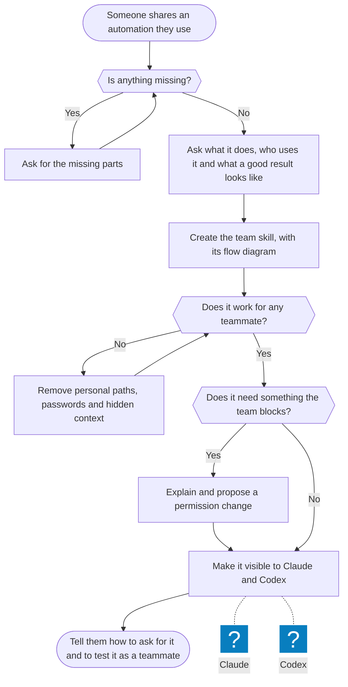

# Migrate a skill to the team

## Flow

Anyone on the team may have automations that live only on their own computer. This skill turns
one of them into a team skill that works for anyone, without that person's setup, memory or
credentials.

Read `.agents/rules/skills.md` and `.agents/rules/safety.md` before starting.
Talk to the person in plain words; never ask them to edit files or run commands.

## 1. Receive the automation

The person provides it in the chat: pasted text, attached files, a folder path, or a
description. If something is missing (a script the instructions call, a template, an example
of the expected result), ask for it now.

Ask, in one message:
- What it does and **who on the team will use it**.
- **What a good result looks like** (an example output, if they have one).
- How they usually ask for it (the words they would type). This becomes the description.

## 2. Create the team skill

- Pick a short, lowercase, hyphenated name and confirm it with the person.
- Create `.agents/skills/<name>/SKILL.md` with `name` and `description` front matter.
- Right after the title, add the `## Flow` diagram: the steps as boxes and every check or
  question to the person as a hexagon, and the tools it uses joined to their steps, with their
  logos (`.agents/rules/skills.md`). The team page shows it first.
- Move fixed steps into `scripts/` (deterministic first). Keep reasoning steps as instructions.
- Never write into `.claude/` or `.codex/`.

## 3. Make it work for teammates

Check each point and fix it. List what you changed for the summary.

| Check | What to look for | Fix |
|---|---|---|
| Personal paths and data | `/Users/<name>/`, `C:\Users\`, personal emails, personal IDs, a specific machine | Paths relative to the repository; ask for person-specific values at run time |
| Credentials | Tokens, passwords, API keys in the text or scripts | Remove them; read from an environment variable and name it in `SKILL.md` |
| Tools and connectors | Connectors (MCP), commands and programs it calls | List them under `## Tools`; compare with `.agents/permissions.json` (step 4) |
| Hidden context | Things that only worked because of the person's memory, chat history or personal instructions (names, formats, where data lives) | Ask the person; write that context into the skill or propose a team rule in `.agents/rules/` |
| Outputs | Where results go | Follow `.agents/rules/artifacts.md`; never send messages, only drafts |

## 4. Permissions

Compare the tools the skill needs with `.agents/permissions.json`.
- If the skill needs something that is blocked, explain it in plain words and propose a
  change. Never edit `permissions.json` without the person's agreement.
- If the skill sends messages, change it to prepare drafts instead.

## 5. Sync and hand over

1. Run `sh .agents/system/bin/py .agents/system/scripts/sync.py` so Claude Code and Codex both see the skill.
2. Tell the person, briefly:
   - the skill's name and how to ask for it,
   - what you changed so it works for others (from step 3),
   - any permission change you proposed and whether it was applied,
   - the next step: test it as a teammate would, without the person's own setup,
     and then ask one teammate to try it.

## Tools

- Shell: `sh .agents/system/bin/py .agents/system/scripts/sync.py`, `sh .agents/system/bin/py .agents/system/scripts/find_logo.py` (logo search on the internet)
- File read and write inside `.agents/`
